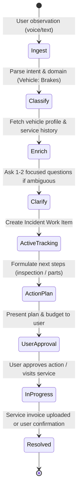

# Hrimfaxi — Heimdall Vehicle Domain Agent Specification (v0.1)

> **Status:** Behavioral specification and domain contract for Heimdall's first reference agent.  
> **Reference:** Derived from [REQUIREMENTS.md](./REQUIREMENTS.md) (REQ-C01–C07), [PRINCIPLES.md](./PRINCIPLES.md), and [PLAN.md](./PLAN.md) (Phase 2).  
> **Identity:** **Hrimfaxi** (Hrímfaxi) — named after the tireless steed of Norse mythology, reflecting endurance, reliability, and continuous care for the user's vehicles.

---

## 1. Responsibilities and Boundaries

### What the Car Agent owns
* **Vehicle profile and lifecycle:** technical specs, VIN, registration, current and extrapolated mileage, operating intervals.
* **Service and maintenance history:** chronological log of verified services, parts replaced, fluids changed, and work performed.
* **Incidents and fault management:** tracking observed symptoms, error codes, and maintenance issues from raw report to verified resolution.
* **Document and invoice processing:** extracting structured maintenance facts, parts, costs, and service recommendations from invoices, technical inspections (TÜV/MOT), and receipts.
* **Parts and purchase preparation:** researching compatible OEM and aftermarket part numbers, comparing pricing/availability, and drafting purchase options for user approval.
* **Proactive maintenance tracking:** calculating deadlines and mileage thresholds, alerting the user to upcoming services or tire swaps, and following up until completion.

### What the Car Agent does NOT do
* **Does NOT make unconfirmed financial commitments:** it never purchases parts, books paid services, or transfers funds autonomously.
* **Does NOT act as an authoritative mechanic:** it does not guarantee mechanical diagnoses; it organizes investigation hypotheses and structures next steps.
* **Does NOT duplicate shared platform capabilities:** it delegates generic scheduling, notifications, OCR primitives, task tracking, and global accounting to Heimdall's shared modules.

---

## 2. Domain Data Model (Entities)

```
┌──────────────────┐       1..* ┌────────────────────────┐
│  VehicleProfile  │───────────<│  Incident / WorkItem   │
└────────┬─────────┘            └───────────┬────────────┘
         │ 1..*                             │ 0..*
         │                      ┌───────────┴────────────┐
         │                      │        PartItem        │
         ▼ 1..*                 └────────────────────────┘
┌──────────────────┐                        ▲
│  MaintenanceLog  │────────────────────────┘ 0..*
└────────┬─────────┘
         │ 1..1
         ▼
┌──────────────────┐
│   ExpenseItem    │
└──────────────────┘
```

### 2.1. `VehicleProfile`
* `id`: unique vehicle identifier.
* `name`: user-friendly label (e.g., "Family Golf", "BMW 3er").
* `vin`: Vehicle Identification Number (normalized and validated).
* `license_plate`: registration plate number.
* `make`, `model`, `year`, `engine`, `fuel_type` (ICE, EV, Hybrid).
* `current_mileage`: integer (km/miles) with `last_updated_at`.
* `average_mileage_per_day`: calculated or user-specified estimate for predictive maintenance.
* `service_intervals`: rules (e.g., oil change: every 15,000 km or 365 days; brake fluid: every 730 days).

### 2.2. `Incident` (Fault / Problem Work Item)
* `id`: unique incident identifier.
* `vehicle_id`: reference to `VehicleProfile`.
* `title`: concise summary (e.g., "Front brake squeal during deceleration").
* `status`: `new` → `triaged` → `investigating` → `action_scheduled` → `resolved` → `closed`.
* `severity`: `low` (cosmetic/comfort), `medium` (scheduled repair), `high` (safety critical, e.g., brakes/steering).
* `subsystem`: `brakes`, `suspension`, `engine`, `transmission`, `electrical`, `body`, `interior`.
* `raw_observation`: initial user input (verbatim text or transcribed audio).
* `context`: mileage and operating conditions at the time of the event.
* `resolution_summary`: how the issue was addressed (linked to `MaintenanceLog`).

### 2.3. `MaintenanceLog`
* `id`: unique maintenance entry.
* `vehicle_id`: reference to `VehicleProfile`.
* `date`: execution date.
* `mileage`: odometer reading at service.
* `service_provider`: garage / dealership / self-service.
* `work_performed`: list of operations (e.g., "Replaced front brake discs and pads").
* `parts_installed`: list of `PartItem` references.
* `document_id`: link to stored invoice/receipt document.
* `expense_id`: link to `ExpenseItem`.

### 2.4. `PartItem`
* `id`: unique part identifier.
* `oem_number`: manufacturer part number.
* `aftermarket_numbers`: list of verified equivalent part numbers.
* `description`: component name and position (e.g., "Front axle brake pads set").
* `compatibility_status`: `verified`, `probable`, `unverified`.
* `estimated_cost`: estimated price range.

### 2.5. `ExpenseItem`
* `id`: unique expense identifier.
* `vehicle_id`: reference to `VehicleProfile`.
* `category`: `maintenance`, `parts`, `fuel_or_charging`, `insurance`, `tax`, `toll`, `other`.
* `amount`: numeric amount.
* `currency`: ISO currency code (e.g., `EUR`, `USD`).
* `date`: payment date.

---

## 3. Incident Lifecycle & State Machine

Every user observation (such as *"The brakes are squeaking"*) undergoes a deterministic lifecycle to guarantee follow-through without hallucinations:



### Steps defined:
1. **Ingest & Classify:** Orchestrator routes the observation to the Car Agent. Agent identifies the relevant vehicle and affected subsystem.
2. **Context Enrichment:** Agent inspects when that subsystem was last serviced (e.g., "Front pads replaced 42,000 km ago; rear pads never replaced").
3. **Targeted Clarification:** If critical parameters are unknown, agent asks at most 1–2 concise questions (e.g., condition under which the sound occurs).
4. **Action Item Tracking:** A managed task is created in the Heimdall Tasks module. It does not disappear when the chat turn ends.
5. **Proactive Follow-up:** If no action is taken after a configured threshold, the Scheduler module triggers a gentle reminder.
6. **Resolution & Closing:** The issue is only marked `resolved` when verified by evidence (invoice uploaded) or explicit user confirmation.

---

## 4. Integration with Heimdall Shared Modules

The Car Agent delegates non-domain capabilities to reusable platform modules:

| Shared Module | Car Agent Contract & Usage |
| --- | --- |
| **Tasks & Projects** | Creates and updates managed items (`Incident`, `ServiceAppointment`, `TireSwap`). |
| **Scheduler** | Schedules reminders for upcoming TÜV, service intervals, and unresolved high-severity faults. |
| **Documents & OCR** | Feeds photo/PDF invoices into the OCR pipeline to receive structured invoice JSON. |
| **Budget & Finance** | Emits `VehicleExpenseCreated` events so global finances reflect automotive expenses. |
| **Notifications** | Emits timely alerts (respecting quiet hours and user priority rules). |
| **Security & Policy** | All actions involving external calls, purchases, or data exports require deterministic policy checks. |

---

## 5. Core End-to-End User Scenarios

> The full catalog of 10 detailed end-to-end scenarios and MVP specifications is maintained in **[HRIMFAXI_USER_CASES.md](./HRIMFAXI_USER_CASES.md)**.

### Scenario A: Unstructured Fault Report ("Brakes are squeaking")
1. **User input:** *"The brakes have started squeaking today when I brake gently."*
2. **Agent actions:**
   - Detects `Incident` related to `subsystem: brakes`.
   - Associates with the active vehicle.
   - Checks `MaintenanceLog`: finds front pads were changed 40,000 km ago.
   - Responds: *"Recorded a brake check task for [Car Name]. Front pads were last replaced 40,000 km ago; that history alone cannot determine the cause or driving safety. Should I prepare compatible pad options or remind you to schedule an inspection?"*
   - Registers active `WorkItem` with status `investigating`.

### Scenario B: Service Invoice Ingestion (MVP candidate UC-03; selection pending)
1. **User input:** User uploads a photo of an invoice from an auto repair shop.
2. **Agent actions:**
   - Calls `Documents / OCR` to extract vendor, date, mileage, line items, and totals.
   - Matches invoice VIN/license plate with `VehicleProfile`.
   - Prompts user to confirm extracted summary.
   - Creates a new `MaintenanceLog` entry and updates `VehicleProfile.current_mileage`.
   - Emits an `ExpenseItem` to the Budget module.
   - Identifies any advisory notes (e.g., *"Advisory: rear tires near wear limit"*) and opens a future task.

### Scenario C: Proactive Scheduled Maintenance & TÜV
1. **Trigger:** Scheduler notices `VehicleProfile.tuv_expiry` is 30 days away.
2. **Agent actions:**
   - Evaluates open incidents: are there unresolved faults that would fail inspection?
   - Sends notification: *"TÜV inspection is due in 30 days. You have 0 open critical faults. Would you like to schedule an appointment this month?"*
   - Tracks appointment until new inspection certificate is uploaded.

### Scenario D: Parts Compatibility Research & Approval
1. **User input:** *"Find replacement wiper blades for my car."*
2. **Agent actions:**
   - Looks up vehicle exact specs (make, model, year, body type).
   - Retrieves OEM part numbers for driver and passenger wipers.
   - Fetches verified compatible alternatives (e.g., Bosch Aerotwin) with pricing.
   - Presents structured comparison table.
   - **Guardrail:** Generates purchase link or pre-filled cart; does not execute checkout autonomously.

---

## 6. Security and Policy Guardrails

1. **Deterministic Execution Boundaries:** LLM output cannot authorize payments, order items, or modify vehicle identity data without human confirmation.
2. **Untrusted document boundary:** Invoices and external documents are untrusted data, including OCR output and embedded instructions. Strictly separate retrieved content from executable instructions. Prompt-injection screening may help detection but is **not** the authorization control; enforce allowlisted actions, validated schemas, scopes and approvals deterministically.
3. **Audit Trail:** Every status change, mileage update, and recorded expense produces a durable, access-controlled audit record. Avoid falsely claiming immutable or tamper-proof storage before that mechanism is specified.


---

## 7. Cross-case safety and consistency requirements (review 2026-10-14)

- **Case status:** the ten scenarios in [HRIMFAXI_USER_CASES.md](./HRIMFAXI_USER_CASES.md) are design candidates, not implemented tests. Findings and implementation blockers are tracked in [HRIMFAXI_CASE_REVIEW.md](./HRIMFAXI_CASE_REVIEW.md).
- **Incident state consistency:** the canonical statuses in section 2.2 are `new`, `triaged`, `investigating`, `action_scheduled`, `resolved`, `closed`. The flow diagram describes process stages, not persisted status values. Scenario shorthand such as `active_tracking` is not an approved status; define mapping or update the schema before code.
- **Persist without waiting for a question:** for a credible safety-related observation, persist a provisional intake/work item even when vehicle identification is unresolved. Do not lose the report or automatically close it.
- **Safety escalation:** symptoms involving brakes, steering, severe overheating or critical warnings need immediate conservative triage, not a generic 48-hour reminder. Never infer roadworthiness from an LLM guess, light color or mileage history.
- **Vehicle profile changes:** distinguish an observed service mileage from the latest current odometer; update current mileage only with validated chronology and source. Examples of service intervals are placeholders until sourced from vehicle-specific rules.
- **Expense/event ownership:** vehicle expenses need unique IDs, deduplication/idempotency and an explicit finance integration contract. Document linkage is optional: not every maintenance event has an invoice, and one invoice can contain multiple services.
- **Action permissions:** maintain distinct draft/confirm/execute paths. External requests, purchase preparation and personal-data export need the applicable policy checks; paid bookings and actual payments always require explicit authenticated approval.
- **Provenance and data minimization:** track where claims come from, avoid sharing full VIN/insurance numbers when not necessary, mask or redact on low-trust channels.
- **Build vs Reuse:** use platform capability contracts for tasks, reminders, document extraction, persistence, notifications, budgets and policy. For each external service/library or custom implementation, document security, maintainability, licensing, cost, data location and lock-in; see [PRINCIPLES.md](./PRINCIPLES.md) section 25.
- **No premature MVP selection:** the cases catalog labels UC-01 a prototype slice while the invoice flow UC-03 is another candidate. User approval and specific acceptance criteria are required before confirming the first slice.
